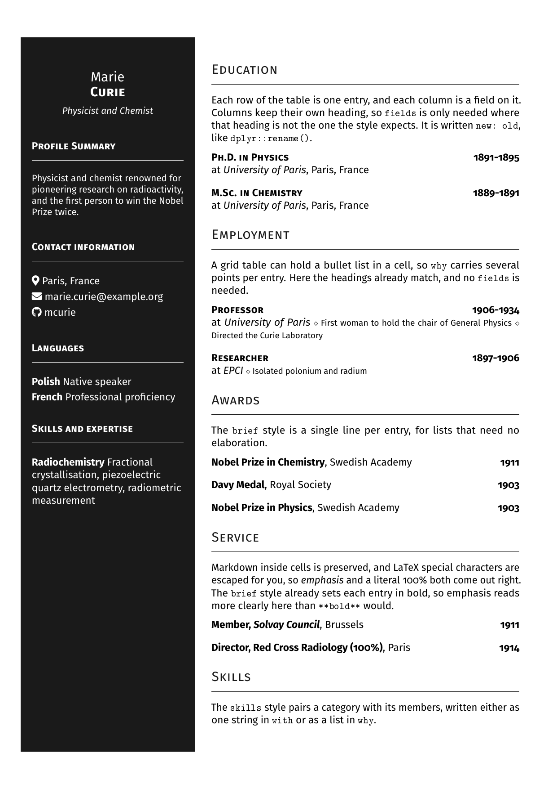

# LuxSleek CV

A Quarto format for writing a CV with **LuxSleek-CV**, a two-column LaTeX
template by Andreï V. Kostyrka, University of Luxembourg: a tinted dark
sidebar of contacts, languages and skills down the left, and a white main
column of entries on the right. CV entries are written as tables, either by
hand or generated by code.

<table>
<tr>
<td width="320"></td>
<td><code>format: luxsleek-pdf</code><br>A header of name and photo in the sidebar, sections built from <code>.entries</code> tables in the main column, in the <code>detailed</code>, <code>brief</code> and <code>skills</code> styles, and a <code>sidebar:</code> block for anything that belongs in the tinted column instead.</td>
</tr>
</table>

## Installing

```bash
quarto use template quarto-vitae/luxsleek
```

This installs the extension and creates a starting `template.qmd`. To add the
format to a document you already have, use `quarto add quarto-vitae/luxsleek`.

Rendering needs a LaTeX installation with **pdflatex**. If you have no LaTeX,
`quarto install tinytex` will do; the fonts are fetched on the first render.

## Using

Set the format and describe yourself in the YAML header:

```yaml
---
name: Marie
surname: Curie
position: "Physicist and Chemist"
social:
  - address: "Paris, France"
  - email: "marie.curie@example.org"
  - github: mcurie
aboutme: "A short line under your name, in the sidebar's Profile Summary."
format: luxsleek-pdf
---
```

Write each section as a heading, and each listing as a table inside an
`.entries` div. One row becomes one entry, and one column becomes one field on
it, named by its heading:

```markdown
# Education

::: {.entries style="detailed"}
| what             | with                | when      | where         |
|------------------|---------------------|-----------|---------------|
| Ph.D. in Physics | University of Paris | 1891-1895 | Paris, France |
:::
```

Where your data uses different headings, rename them with `fields`, written
`new: old` in the manner of `dplyr::rename()`:

```markdown
::: {.entries style="detailed" fields="{what: Degree, with: Institution, when: Years}"}
```

Markdown inside table cells is preserved, so `**bold**`, `*italic*` and links
all work. LaTeX special characters are escaped for you exactly once, so a
literal `100%` needs no backslash.

### The tinted sidebar

Section headings (`#`, `##`) and `.entries` tables only ever reach the white
main column. The dark sidebar is filled separately, from `sidebar:` front
matter: a list of sections, each with a `title` and a list of `items`. This is
how upstream's own Languages and Skills-and-expertise blocks are written:

```yaml
sidebar:
  - title: Languages
    items:
      - "**Polish** Native speaker"
      - "**French** Professional proficiency"
  - title: Skills and expertise
    items:
      - "**Radiochemistry** Fractional crystallisation, piezoelectric quartz electrometry"
```

Contact details are given as a `social` list (`address`, `phone`, `email`,
`website`, `github`, `linkedin` and more, in the order written, as documented
by [curriculum](https://github.com/mitchelloharawild/curriculum)) and are
placed in the sidebar automatically and need no `sidebar:` entry of their own.
`aboutme` fills the sidebar's fixed Profile Summary block, under the name.

### Entries from code

More often the data lives in a data frame, and the same options are given as
cell options. The cell prints a table and the filter picks it up:

````markdown
```{r}
#| echo: false
#| vitae:
#|   style: detailed
#|   fields:
#|     what: degree
#|     with: institution
#|     when: years
education |> filter(completed)
```
````

Entries can also come from a CSV printed by a cell, from several tables in one
div, or carry bullet lists written in grid table cells. Those are covered in the
[vitae documentation](https://quarto-vitae.github.io/).

## Styles

This format implements the three conventional vitae listing styles, all in the
white main column.

`detailed`
: A two-line entry: `what` in bold small caps with `when` flush right, then
  `with` in italic on the line beneath (with `where` appended), and a bulleted
  elaboration built from `why`. Suits education and employment. This is the
  style used when none is given.

`brief`
: A single line, from `what`, `with`, `where` and `when`, with no elaboration.
  Suits awards, memberships and service.

`skills`
: A category in `what`, followed either by its members as one string in `with`
  or, for a longer list, as a bulleted elaboration from `why`. Note that this
  is a different thing from the sidebar's own Skills-and-expertise block
  above: this style is for a skills *section in the main column*, written the
  same way as any other listing.

## Format options

Set these in the YAML header. All are optional except `name`.

### Header and sidebar contents

| Option | Effect |
|--------|--------|
| `name`, `surname` | The name shown at the top of the sidebar |
| `position` | A line of roles under the name |
| `profilepic` | Path to a profile image, shown above the name |
| `profilepic-width` | Width of the photo, defaulting to `0.55\linewidth` |
| `aboutme` | Fills the sidebar's Profile Summary block |
| `social` | List of `service: handle` contact details, one per line in the sidebar |
| `contacts-title` | Heading over the contact block, defaulting to "Contact information" |
| `sidebar` | A list of `{title, items}` blocks filling the rest of the sidebar, such as Languages or Skills and expertise |

### Appearance

| Option | Effect |
|--------|--------|
| `headcolor` | The sidebar's fill colour, and the colour main-column headings are set in, as a hex string such as `"8C1E1E"`. Defaults to upstream's near-black. |
| `sidebar-ratio` | Width of the sidebar as a fraction of the page, defaulting to `0.33`. |
| `columnsep` | Gap between the sidebar and the main column, defaulting to `18pt`. |
| `fontsize` | Base font size, defaulting to `11pt`. |
| `papersize` | Paper size, defaulting to `a4`. Use `letter` for US letter. |
| `geometry` | Page margins, passed to the `geometry` package. |
| `linestretch` | Line spacing. |
| `colorlinks` | Set to `true` to colour links. Off by default, matching upstream, which does not colour its links either. |

### Typography

Upstream uses FiraSans throughout. Set `fontfamily` to any LaTeX font package
name to replace it (`raleway`, say), or `mainfont`/`mainfontoptions` to use any
font installed on your system with `xelatex`/`lualatex`.

## Licensing

This extension's own code is released under CC BY-SA 4.0, see
[LICENSE.md](LICENSE.md). Its design and typography are adapted from
[LuxSleek-CV 1.1](https://www.overleaf.com/latex/templates/luxsleek-cv/qbvbqmrzxwyj)
by **Andreï V. Kostyrka**, University of Luxembourg, released under CC BY 4.0.

---

> [!TIP]
> **This is one of several vitae templates for Quarto.**
>
> They share the same entry syntax, so a CV written here can be rendered with a
> different design by changing the `format:` line. To browse the other
> templates, read the full guide to writing a CV, or build a template of your
> own, visit <https://quarto-vitae.github.io/>.
